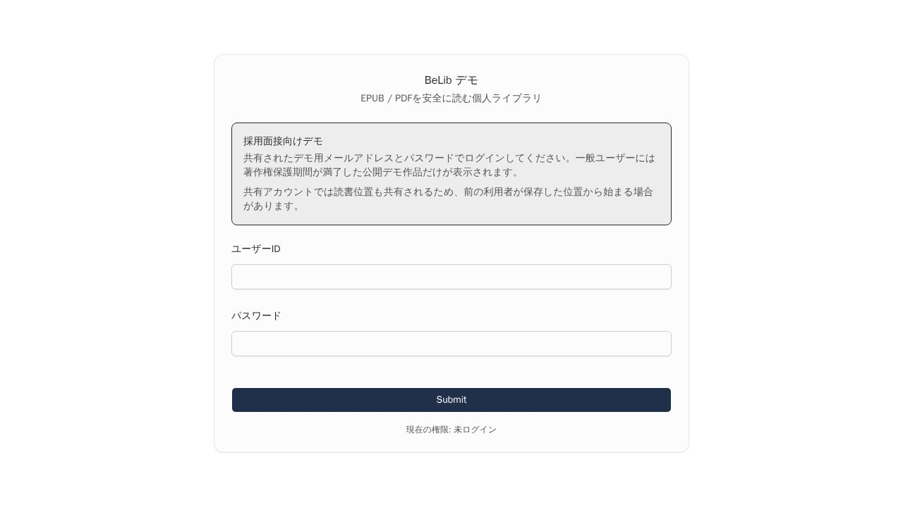
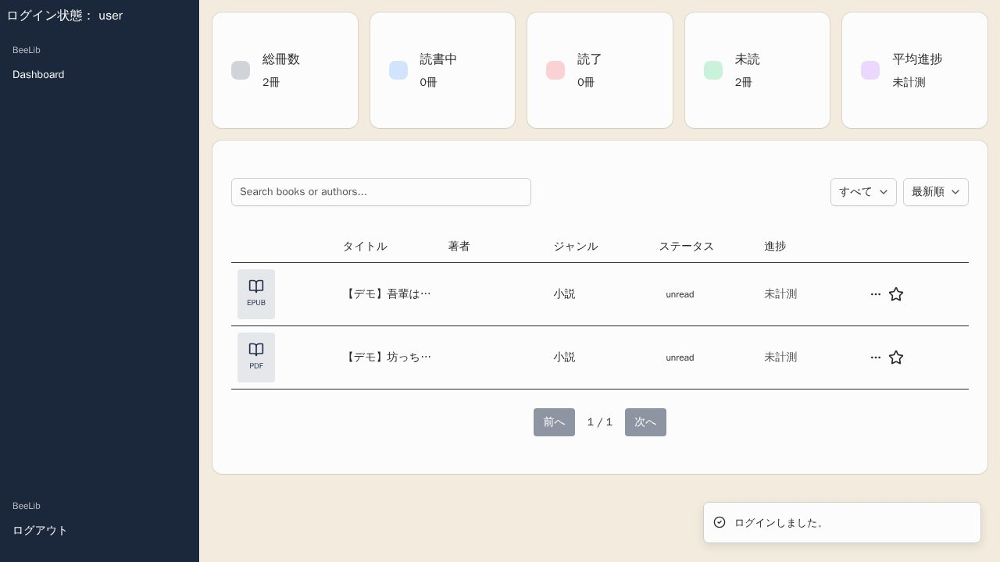

# BeLib — EPUB・PDFをブラウザで読める個人ライブラリ

**React / TypeScript × Hono × PostgreSQL で開発した、認証・アクセス制御付きの読書Webアプリです。**

電子書籍をただ一覧表示するだけでなく、「誰がその本を閲覧できるか」「読みかけの位置をどう復元するか」「ファイルを安全に配信するか」を、フロントエンドからAPI・DB・テストまで一つのアプリとして実装しました。

**[Webデモを見る](https://belib.hiroyuki9614.com/login)** · [画面イメージ](#画面イメージ) · [技術的な工夫](#技術的な工夫) · [ソース・設計資料](#ソース設計資料)

> **デモの稼働状況（2026年11月4日）**：現在、本番環境の障害を調査しています。接続できない場合は、以下のスクリーンショットとソースコードから実装内容をご覧ください。復旧後、この注記を更新します。

## どんなアプリか

個人のEPUB・PDFを登録・整理し、ブラウザで読むためのWebアプリです。管理者だけが閲覧できる蔵書と、一般ユーザーに公開する書籍を、サーバー側の権限判定で分離しています。

| 主な機能 | 実装内容 |
| --- | --- |
| ログイン | Better Auth のCookieセッションを利用した認証 |
| 書籍管理 | EPUB/PDFの登録、タイトル・著者検索、カテゴリでの絞り込み |
| 閲覧制御 | ロール別の書籍一覧・詳細・ファイル取得の制御。未認証は401、権限なしは403 |
| ブラウザ読書 | EPUBリーダーとPDFリーダー。目次・ページ移動に対応 |
| 続きから読む | PDFのページ番号とEPUBのCFIをPostgreSQLに保存・復元 |
| ファイル配信 | 認証・認可後に、保護されたローカルファイルまたはCloudflare R2の署名URLで配信 |

## 画面イメージ

<details open>
<summary>ログイン画面・一般ユーザー向け本棚</summary>





</details>

一般ユーザー向けデモでは、管理者の個人蔵書を見せない設計です。公開サインアップは無効で、デモ用認証情報と管理者の認証情報を分離しています。

## 担当した領域

**個人開発のポートフォリオ**として、画面実装に加えてAPI、データモデル、認証・認可、読書状態の保存、テスト、本番運用・CI/CDの整備に取り組んでいます。

| 領域 | 主な技術・実装 |
| --- | --- |
| フロントエンド | React 19、TypeScript、Vite、React Router、Tailwind CSS、shadcn/ui、TanStack Query |
| バックエンド | Node.js、Hono、TypeScript、Better Auth、OpenAPI |
| データベース | PostgreSQL、Prisma、マイグレーション |
| ファイル保存 | Cloudflare R2、署名付きURL、ローカル開発用ストレージ |
| 品質保証 | Vitest、Playwright、実PostgreSQLを用いたE2E |
| 運用 | Docker Compose、GitHub Actions、段階的なデプロイと切り戻しの仕組み |

## 技術的な工夫

**1. UIだけに依存しないアクセス制御**

書籍ごとの閲覧可否は、DBの `RoleBookPermission` を基にバックエンドで判定します。書籍一覧だけでなく、詳細・ファイル取得・読書位置のAPIにも同じ権限境界を適用しています。管理画面を隠すだけでは防げない直接APIアクセスも検証対象にしています。

**2. フォーマットが異なる読書位置を一つの仕組みで管理**

PDFはページ番号、EPUBはCFI（電子書籍内の位置情報）を保存します。再ログイン・再読み込み時にPostgreSQL上の進捗を取得して復元するため、単なるブラウザ内状態では終わらない実装です。

**3. 書籍データを公開ディレクトリに置かない**

ファイルはバックエンドで認証・権限確認してから配信します。R2では期限付き署名URLを利用し、R2の秘密鍵をフロントエンドに渡しません。

**4. 認証を含む実際の利用経路をテスト**

単体テストに加え、Playwrightでログイン、公開書籍の閲覧、管理者限定書籍へのアクセス拒否、EPUB/PDFの進捗保存・復元を確認しています。CIではフロントエンド、バックエンド、Reader E2E、Compose構成の4系統を扱います。

## 構成イメージ

```text
React / TypeScript（本棚・管理画面・EPUB/PDF Reader）
               |
               v
Hono / Node.js（認証・ロール別認可・REST API）
        |                         |
        v                         v
PostgreSQL / Prisma         保護ファイルストレージ
（ユーザー・書籍・進捗）     （local / Cloudflare R2）
```

## 現在の実装範囲と今後の課題

認証、権限別の書籍表示、保護されたEPUB/PDFの読書、進捗保存・復元という主要な利用経路は実装しています。一方で、すべての機能が完成済みというわけではありません。

今後の課題は、R2署名URLの閲覧中の自動更新、ファイル差し替え・完全削除、管理機能の拡充、本番デモの継続的な受入検証などです。**CI成功と本番の稼働・リリース承認は別の条件として管理**しています。

## ソース・設計資料

- [実装の現在地と未対応事項](docs/current-status.md)
- [要件定義](docs/requirements.md)
- [API仕様（OpenAPI）](docs/api.yaml)
- [DB設計](docs/database.md) / [Prismaスキーマ](backend/prisma/schema.prisma)
- [デモ環境と安全な公開手順](docs/portfolio-demo.md)
- [開発ルール](AGENTS.md)

## 開発者向け：ローカル起動とテスト

Node.js、npm、Docker Compose、PostgreSQLを使います。環境変数の値は `.env.example` を参照し、秘密情報をGitに保存しないでください。

```bash
npm install
npm install --prefix backend
npm install --prefix frontend
npm run dev
```

- Frontend: `http://localhost:5173`
- Backend: `http://localhost:3000`
- task-owned DBの作成、Prisma migration、seed、E2E用データの準備は [現在の構成・ルール](docs/current-status.md) とリポジトリ内の `.env.example` / `docker-compose.dev.yml` を参照してください。

```bash
npm test
npm run build:backend
npm run build:frontend

# 個別テスト
npm --prefix backend test
npm --prefix frontend test
npm --prefix frontend run test:e2e
```

本番DB/R2のデータや管理者アカウントを、テスト・デモ用途で流用しません。

## License

ISC
