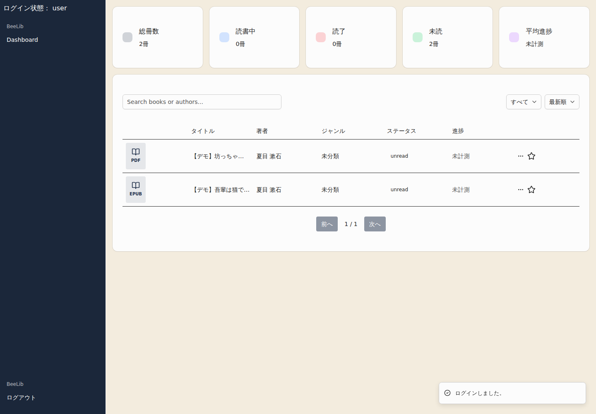
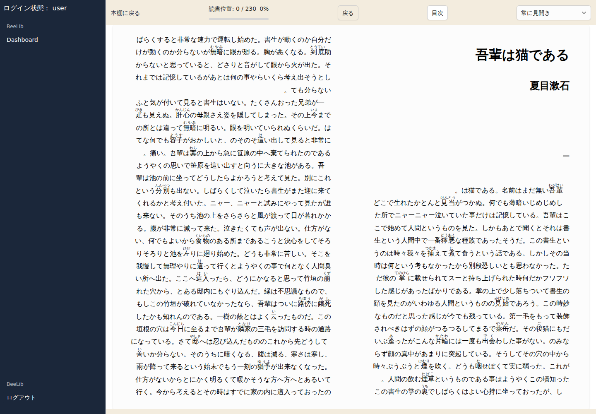
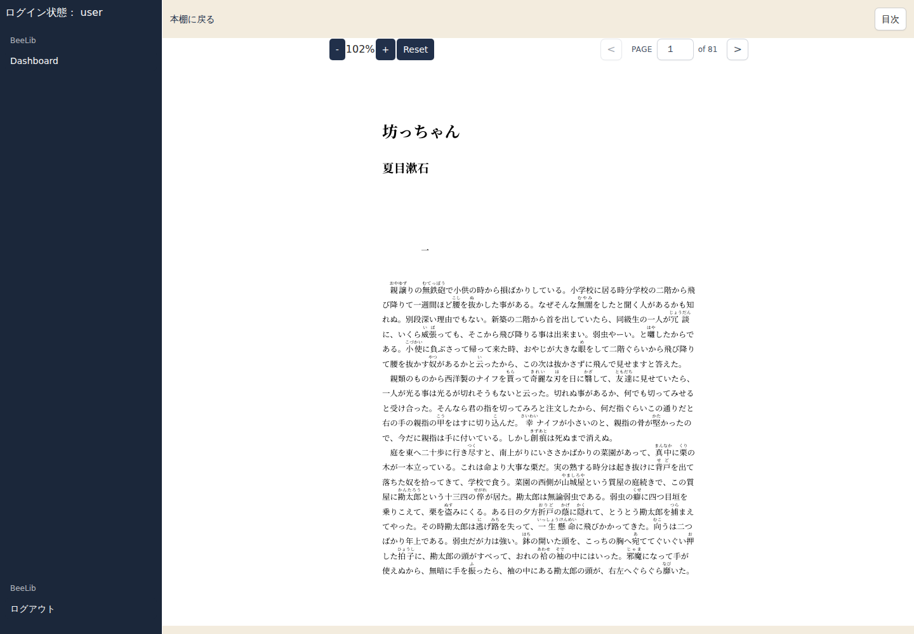
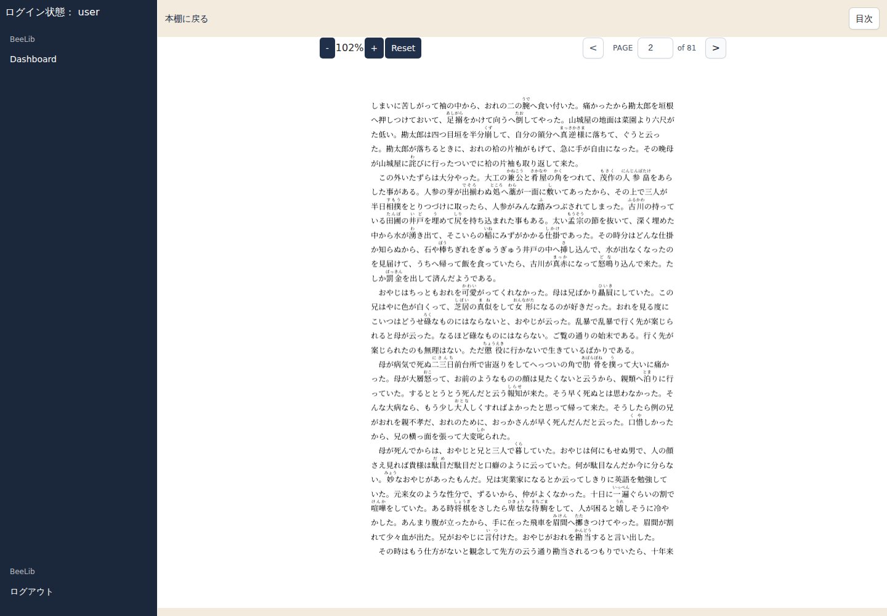
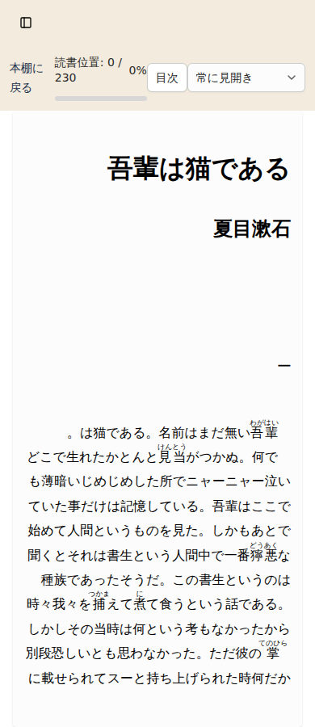

# BeLib portfolio MVP production release — 2026-10-26

Status: **production acceptance passed** at `2026-10-26 23:36:12 JST` on <https://belib.hiroyuki9614.com>.

This record intentionally omits credentials, cookies, signed URLs, R2 object keys, backup paths/content, and the titles or IDs of the pre-existing personal books.

## Reviewed source and merge chain

| Change | Reviewed head | Merge commit | Result |
| --- | --- | --- | --- |
| PR #37 — portfolio MVP safety implementation | `0ad8794cc6a3d764ae5d50c2e0f109f42b5d58fc` | `c7530f33708e8f7eb2f94a8b5416bdc74b88e76c` | merged |
| PR #38 — loopback registration origin | `67b5d02d70da3e5bd66ffda16fa7c51a92b9e29d` | `f365c46269cdf369e4d8f06188d4ffd35fbf09e5` | merged |
| PR #40 — production EPUB ArrayBuffer reader | `0d0a610d7d94ddfbafb979a9dee65c9e68f6e784` | `a615f8760fb238586ac34d30c9600d8ac26c928b` | merged |

The PR #40 head and merge commit both resolve to tree `2679561428839e4ffa63e29980b5033cc0f39203`.

Final PR #40 CI succeeded for the fixed head:

- [EPUB protected reader CI](https://github.com/hiroyuki9614/book_library/actions/runs/40338084961/job/121624945529)
- [Non-R2 reading and admin core CI](https://github.com/hiroyuki9614/book_library/actions/runs/40338085546/job/121624948023)
- [Backend tests, build, Prisma, and migrations](https://github.com/hiroyuki9614/book_library/actions/runs/40338085214/job/121624946509)
- [Frontend tests, lint, and build](https://github.com/hiroyuki9614/book_library/actions/runs/40338085214/job/121624946125)
- [Production images, Compose config, and isolated smoke](https://github.com/hiroyuki9614/book_library/actions/runs/40338085214/job/121631634445)

Independent read-only review of `f365c46269cdf369e4d8f06188d4ffd35fbf09e5..0d0a610d7d94ddfbafb979a9dee65c9e68f6e784` found no P0/P1/P2. The earlier EPUB final-location off-by-one was fixed before merge. A remaining P3 is browser memory pressure for very large or highly compressed administrator-uploaded EPUB files; it is not a blocker for the reviewed 1.6 MB demo EPUB and remains roadmap work. Codex Security exact-range scan `b6b87ff9-3e8e-4be8-ae6d-a5570ba69fe3` completed with full two-file coverage and no findings.

## Immutable production deployment

- Application revision: `0d0a610d7d94ddfbafb979a9dee65c9e68f6e784`
- Backend image ID: `sha256:8ef380be0c01af3f97cd91faae70089fe63f3bd2f30e778e0ac95b3d0878519e`
- Frontend image ID: `sha256:0e13875ecbf5d70b93afdb4d71b908cf51d5afc7ee61cd5964ff2d87a78e1db3`
- Migration image ID: `sha256:9ef54bd53970eed60f0f5d674b500a7cca4d4646ca1454e99d56265142ea26b2`
- Release manifest SHA-256: `1a7d7961438bb190448f87c1fc91f7863bd7a416f10882de66c4089c888eac51`
- Database migration result: five migrations known, no pending migration
- Runtime read-back: backend/frontend tag, image ID, and OCI revision matched the fixed head
- Public read-back: `/health` 200 with the expected service payload, `/` 200, public sign-up 403

The previous `67b5d02d…` backend/frontend images and the pre-deploy Compose override are retained privately for a forward-safe rollback. A rollback must not restore the removed general-role permissions on the personal books.

## Backup and data protection

Production database: `belib`, schema `public`, PostgreSQL 16.14.

Before the first write, a PostgreSQL custom-format dump was created in the existing operator-only KAGOYA area:

- Backup ID: `belib-mvp-pre-permission-20261026T132122Z`
- Size: 34,585 bytes
- SHA-256: `e4f21b08711de5433927803098e8a5bcf5a634d41dc3557aea8586b9316dad2f`
- Access: containing directory `0700`, dump `0600`
- Validation: `pg_restore -l` succeeded

A second pre-registration custom dump was also retained:

- Backup ID: `belib-mvp-pre-registration-20261026T135258Z`
- Size: 35,047 bytes
- SHA-256: `d3a08ba5fb71121504f58f6c324fd6b7a231d4a76133fdb53f28e25600e48ec3`
- Validation: `pg_restore -l` succeeded with 113 archive entries

Recovery follows [backup/restore](../runbooks/backup-restore.md). Neither dump, its path, nor its contents are stored in GitHub.

The frozen original two-book set changed as follows in one transaction:

| Counter | Before | After protection | Final |
| --- | ---: | ---: | ---: |
| Original books | 2 | 2 | 2 |
| Original files | 2 | 2 | 2 |
| Original reading rows | 0 | 0 | 0 |
| Original admin permissions | 2 | 2 | 2 |
| Original user permissions | 2 | 0 | 0 |

No original `Book`, `BookFile`, `ReadingInfo`, or R2 object was deleted or rewritten. Final database totals after E2E are four books, four files, two reading rows, four admin-role book permissions, two user-role book permissions, one active administrator, and one active general demo user. The temporary validation administrator and its sessions/account were deleted after the administrator checks.

All four R2 references were read back after deployment: four HEAD checks, four sizes, and four SHA-256 values matched the database. Direct unauthenticated requests to the four known S3-compatible object paths returned non-success responses; no object was anonymously retrieved. This is runtime evidence for known paths, not a Cloudflare control-plane configuration audit.

## Demo books and provenance

- Demo EPUB book ID: `4` — 夏目漱石『吾輩は猫である』
- Demo PDF book ID: `5` — 夏目漱石『坊っちゃん』
- [Aozora Bunko usage guidance](https://www.aozora.gr.jp/guide/kijyunn.html)
- [Official card: 吾輩は猫である](https://www.aozora.gr.jp/cards/000148/card789.html)
- [Official card: 坊っちゃん](https://www.aozora.gr.jp/cards/000148/card752.html)

The pinned source edition, input/proofread credits, and conversion history are recorded in [the demo manifest](../portfolio/aozora-demo-books.json). Copyright expiry and the official source pages were rechecked before generation. The generated EPUB retained Japanese text, ruby, and TOC; the generated PDF had 81 pages with distinct Japanese text on pages 1 and 2.

## Production browser acceptance

Runner: Playwright `1.62.1`, Chromium `151.0.7922.34`, desktop viewport `1440×1000`, mobile viewport `390×844`.

| Acceptance item | Result |
| --- | --- |
| Anonymous list/detail/file/progress APIs return 401; public sign-up is blocked | PASS |
| Demo shelf contains exactly the two demo books; personal books are absent from list/search | PASS |
| General user gets 403 for personal detail, direct reader URL, file/signed URL, progress GET/PATCH, and admin APIs | PASS |
| EPUB signed R2 fetch and production-origin CORS | PASS |
| EPUB Japanese body, no replacement characters, ruby, TOC, chapter movement, page movement, and CFI change | PASS |
| EPUB position restored after reload and after logout/login | PASS |
| PDF page 1 and page 2 render non-empty, different browser images through signed R2/CORS | PASS |
| PDF position restored after reload and after logout/login | PASS |
| Administrator can still access both protected personal books | PASS |
| Mobile login, shelf, and EPUB reader have no document-level horizontal overflow | PASS |

Safe screenshots contain only the demo shelf or public-domain demo content:

## Remaining post-MVP work

- Cloudflare management API access was unavailable, so bucket-level `r2.dev`, custom-domain, and configured-CORS state were not independently audited. Do not describe the control plane as verified private; the evidence above is signed delivery plus denial on known unsigned paths.
- Bound/cancel EPUB download and parsing work and impose an expanded-archive/memory policy for very large administrator uploads.
- Complete the deferred encrypted offsite/three-generation/paired DB-R2 backup program, isolated restore exercises, independent backup audit, broader browser/mobile E2E, and monitoring described in [the roadmap](../roadmap.md).
- Keep the fixed-source XHTML sanitizer hardening item on the roadmap; any future source change requires a fresh active-content review.
